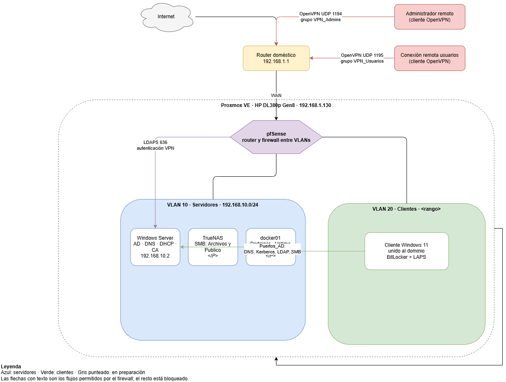

# Laboratorio de infraestructura corporativa

Entorno propio que simula la infraestructura de una pyme: dominio Active Directory, red segmentada con firewall, acceso remoto por VPN con autenticación contra el directorio, almacenamiento en red, cifrado de equipos y servicios en contenedores.

Lo monté para practicar administración de sistemas con servicios que funcionan juntos, y documento cada pieza y cada problema que me encuentro por el camino.

> Sustituye esta imagen por tu diagrama (draw.io → Exportar como PNG) y guárdala en `img/`.

## Hardware y virtualización

| Elemento | Detalle |
|---|---|
| Servidor | HP ProLiant DL380p Gen8, 2x Xeon E5-2630 (12 núcleos / 24 hilos) |
| Memoria | 48 GB DDR3 ECC |
| Almacenamiento | Controladora RAID P420 |
| Hipervisor | Proxmox VE |

El servidor solo se enciende durante las sesiones de práctica para controlar ruido y consumo.

## Redes y VLANs

| VLAN | Nombre | Rango | Contenido |
|---|---|---|---|
| 10 | Servidores | `192.168.10.0/24` | Controlador de dominio, TrueNAS, docker01 |
| 20 | Clientes | `<rango>` | Equipos de usuario Windows 11 |
| 99 | Gestión | `<rango>` | Administración de infraestructura |
| VPN | OpenVPN | `<rango>` | Túnel de administradores |

Todo el enrutamiento y el filtrado entre zonas lo hace pfSense con política de mínimo privilegio: cada zona solo puede hablar con lo estrictamente necesario.

## Servicios

| Área | Servicio | Documento |
|---|---|---|
| Red | pfSense, VLANs y reglas de firewall | [01-red-pfsense](docs/01-red-pfsense.md) |
| Identidad | Active Directory, DNS, DHCP, GPO | [02-active-directory](docs/02-active-directory.md) |
| Almacenamiento | TrueNAS integrado en el dominio, permisos por grupo | [03-truenas-permisos](docs/03-truenas-permisos.md) |
| Acceso remoto | OpenVPN con LDAPS y filtrado por grupo | [04-vpn-ldaps](docs/04-vpn-ldaps.md) |
| Seguridad | LAPS, BitLocker + TPM, CA interna | [05-laps-bitlocker](docs/05-laps-bitlocker.md) |
| Contenedores | Docker, Portainer, Uptime Kuma | [06-docker-portainer](docs/06-docker-portainer.md) |
| Formación | GNS3 por alumno, con plantilla de Windows 11 | [07-gns3-clases](docs/07-gns3-clases.md) |

## Incidencias resueltas

Registro de problemas reales con su diagnóstico y solución: [incidencias](docs/incidencias.md).

## Hoja de ruta

- [x] Red segmentada, VPN y CA interna
- [x] Dominio, LAPS, BitLocker y permisos
- [x] Docker, Portainer y monitorización con alertas
- [ ] Laboratorios de GNS3 para clases (plantilla en pruebas)
- [ ] Backups automáticos con restauración comprobada
- [ ] Reverse proxy con certificados de la CA interna
- [ ] WSUS y MDT
- [ ] Automatización con Ansible
- [ ] Sincronización con Entra ID y certificación AZ-104

## Aviso

Este repositorio no incluye contraseñas, claves privadas, certificados ni perfiles de VPN. Los datos sensibles están sustituidos por marcadores como `<contraseña>`.
