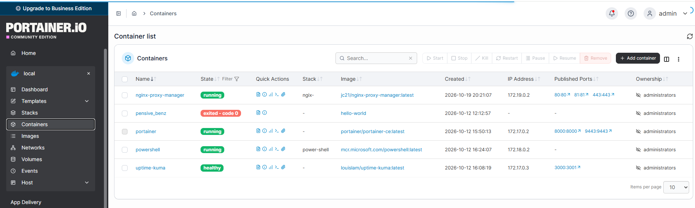
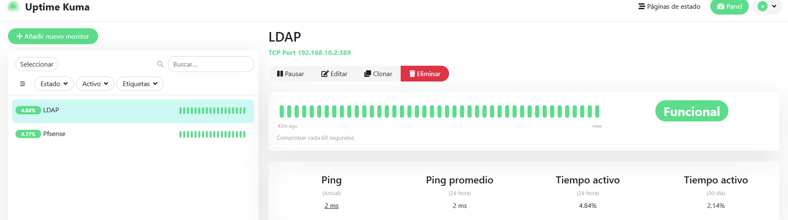

# Plataforma de contenedores: Docker, Portainer y Monitorización

Estado: `operativo` | Última revisión: `18/10/2026`

---

# Objetivo

Disponer de una plataforma de servicios Linux ligera, flexible y fácilmente reproducible para desplegar aplicaciones internas de administración y monitorización.

La solución permite:

- Desplegar servicios de forma rápida.
- Gestionar contenedores mediante interfaz web.
- Supervisar la infraestructura corporativa.
- Facilitar futuras automatizaciones.

---

# Tecnologías utilizadas

- Ubuntu Server
- Docker Engine
- Docker Compose
- Portainer CE
- Uptime Kuma
- OpenSSH

---

# Arquitectura

```text
Proxmox
    │
    ▼
docker01 (Ubuntu Server)
    │
    ├── Docker Engine
    │
    ├── Portainer
    │      └── Gestión de contenedores
    │
    └── Uptime Kuma
           └── Monitorización y alertas
```

---

# Ubicación dentro de la infraestructura

| Parámetro | Valor |
|----------|---------|
| Máquina virtual | `docker01` |
| Plataforma | Ubuntu Server |
| VLAN | 10 (Servidores) |
| Hipervisor | Proxmox VE |
| Gestión remota | SSH |
| Orquestación | Docker Compose |

---

# Docker

## Función

Docker permite desplegar aplicaciones de forma aislada mediante contenedores.

La plataforma se utiliza para:

- Servicios internos.
- Herramientas de administración.
- Sistemas de monitorización.
- Automatizaciones futuras.

---

## Beneficios

- Bajo consumo de recursos.
- Despliegue reproducible.
- Actualizaciones simplificadas.
- Separación entre aplicaciones.

---

# Portainer

## Objetivo

Proporcionar una interfaz web para la administración de Docker.

---

## Funcionalidades utilizadas

- Despliegue de stacks.
- Gestión de contenedores.
- Gestión de imágenes.
- Gestión de volúmenes.
- Gestión de redes Docker.

---

## Acceso

Puerto:

```text
9443/TCP
```

---

## Consideraciones de seguridad

Portainer utiliza:

```text
/var/run/docker.sock
```

Por lo tanto, dispone de acceso completo al motor Docker.

Medidas aplicadas:

- Acceso restringido a la VLAN de servidores.
- Acceso desde estaciones administrativas.
- Acceso remoto únicamente mediante VPN.


### Ejemplo



---

# Uptime Kuma

## Objetivo

Supervisar la disponibilidad de los servicios críticos de la infraestructura.

---

## Servicios monitorizados

### Infraestructura

- pfSense
- Proxmox
- Docker

### Directorio

- Active Directory
- LDAPS (TCP 636)

### Almacenamiento

- TrueNAS

### Servicios web

- Interfaz web de Proxmox
- Servicios internos

---

## Sistema de alertas

Cuando un servicio deja de responder:

- Se genera una alerta.
- Se envía una notificación.
- Se registra el incidente.

---

## Validaciones realizadas

### Monitorización positiva

✅ Servicio accesible.

Estado:

```text
UP
```

---

### Monitorización negativa

✅ Apagado controlado de un servicio monitorizado.

Resultado:

```text
DOWN
```

✅ Recepción de alerta correcta.

---

# Integración con la infraestructura

La plataforma Docker forma parte de la VLAN de servidores y monitoriza servicios críticos de todo el entorno:

```text
pfSense
├── OpenVPN
├── VLANs
└── Firewall

Active Directory
├── DNS
├── DHCP
└── LDAPS

TrueNAS
└── SMB

Proxmox
└── Virtualización
```

---

# Capacidades demostradas

Mediante esta plataforma se han puesto en práctica conocimientos de:

- Administración Linux.
- Docker.
- Docker Compose.
- Gestión de contenedores.
- Monitorización de servicios.
- Diagnóstico de incidencias.
- Seguridad de plataformas de contenedores.
- Integración entre servicios Linux y Windows.

### Ejemplo



---

# Lecciones aprendidas

- Docker simplifica enormemente el despliegue de servicios.
- Portainer facilita la administración centralizada.
- La monitorización temprana reduce los tiempos de respuesta ante incidencias.
- El acceso al socket Docker debe protegerse adecuadamente.

---

# Mejoras previstas

## Infraestructura

- Nginx Proxy Manager.
- Resolución por nombre interno.
- Certificados emitidos por la CA corporativa.

## Monitorización

- Grafana.
- Prometheus.
- Dashboards centralizados.

## Automatización

- Contenedores PowerShell.
- Scripts de mantenimiento.
- Automatización de tareas administrativas.

## Seguridad

- Reverse Proxy.
- Autenticación centralizada.
- Segmentación adicional de servicios.

## Problemas encontrados

Ver [incidencias](incidencias.md).
